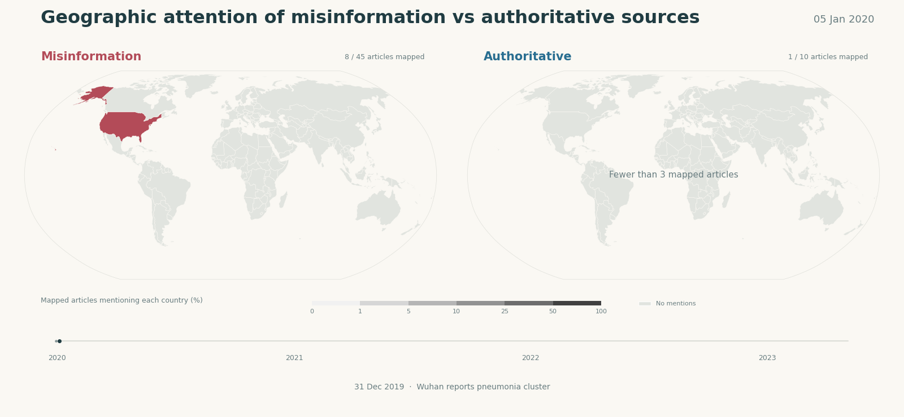
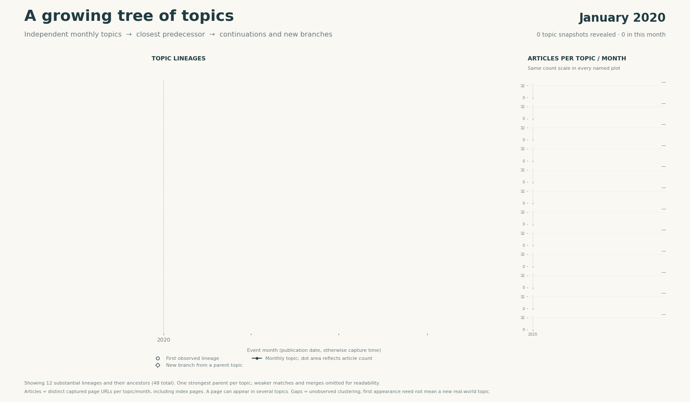

> Tracing COVID-era information spread



A pipeline that harvests archived COVID-related web pages (classified by source credibility) and analyses how each tier evolved along geographic and semantic space.
The animated maps above compare geographic attention in misinformation and
authoritative sources. Country shading shows the share of mapped articles
mentioning each country in a rolling four-week window, with dated pandemic
events beneath the timeline. The study uses the following pandemic phases:

- **P0_outbreak** (Dec 2019 – Jan 2020)
- **P1_global onset** (Feb – Nov 2020)
- **P2_pre-vaccine** (Dec 2020)
- **P3_vaccine rollout** (Jan – May 2021)
- **P4_delta wave** (Jun – Nov 2021)
- **P5_omicron wave** (Dec 2021 – Jun 2022)
- **P6_transition end** (Jul 2022 – May 2023)

The major milestones defining the phases are detailed with sources in [src/config.py](src/config.py)

> Does low-credibility content disperse, geographically and semantically, in ways that authoritative reporting does not?

## Data sources

Three Archive-It collections, chosen to give the hypothesis a comparative pair plus one generalisation probe.

| ID                                                | Name                                     | Tier      | Active seeds | Curator                                               | Role in the study                                                                                                                      |
| ------------------------------------------------- | ---------------------------------------- | --------- | -----------: | ----------------------------------------------------- | -------------------------------------------------------------------------------------------------------------------------------------- |
| [13559](https://archive-it.org/collections/13559) | False Coronavirus (COVID-19) Information | **low**   |           99 | NewsGuard Coronavirus Misinformation Tracking Center  | A tightly curated seed list of sites flagged as COVID-misinfo publishers.                                                              |
| [13529](https://archive-it.org/collections/13529) | Novel Coronavirus (COVID-19)             | **mixed** |       16,385 | International Internet Preservation Consortium (IIPC) | Mainstream/global COVID coverage (multilingual). The contrast set for 13559.                                                           |
| [4887](https://archive-it.org/collections/4887)   | Global Health Events                     | **mixed** |           34 | National Library of Medicine (U.S.)                   | Originally included to test generalisations beyond COVID (Ebola, Zika). **Dropped** from the primary analysis due to low active seeds. |

### Expanding authoritative coverage

[sources.py](src/credibility/sources.py) groups reviewed domains into national
health authorities, regional health departments, medical journals, medical
institutions, and scientific publishers/repositories. Add the narrowest relevant
institutional host and document its ownership. A parent entry already covers its
subdomains; general university, government and hosting roots would make the
comparison too broad. The tier describes the source, not the correctness of
every article, and the included preprint repositories contain unreviewed work.

After editing the list, update the existing registry locally:

```bash
uv run python scripts/build_credibility.py --refresh-authoritative
```

This preserves custom authoritative entries, removes shadowed lower-tier hosts,
and saves a dated backup. It makes no Archive-It requests. Rerun the georeferencing
notebook to update the analysis and GIF: its loader resolves both document and
mention tiers from the current registry while reusing the cached geography.
Cached georef JSONL files retain their original labels; NER need not run again.

Expanding the registry recognises sources already harvested. Increasing the
underlying corpus requires collecting more authoritative pages across phases.
The harvest CLI's `--match-type host` can include article paths beyond the exact
seed URL, where those pages exist in the archive.

## Pipeline

```
            Archive-It CDX  ─►  harvest   ─►  raw captures
                                                  │
                                                  ▼
                                              normalize +
                                             trafilatura +
                                            fast-langdetect
                                                  │
                                    ┌─────────────┼─────────────┐
                                    ▼             ▼             ▼
                               embedings   georeferencing   EDA notebooks
                               (Qdrant)  (spaCy + GeoNames)
```

Stages write reusable artifacts so steps are independently re-runnable:

Build an immutable snapshot with **`credleaf_build_corpus`**, then analyze its ID
with **`credleaf_analyze_corpus`**. Per-collection task groups isolate failures;
checksummed artifacts and explicit build/reuse/off modes make reruns auditable.
Each run produces a Markdown/JSON overview of outputs and actual task states. See
[Airflow setup and controls](airflow/README.md) for installation, the complete
settings table and examples of rerunning downstream steps from existing data.

| Stage             | Where                                                        | Output                                               |
| ----------------- | ------------------------------------------------------------ | ---------------------------------------------------- |
| Harvest           | [scripts/harvest.py](scripts/harvest.py)                     | `data/raw/captures/{cid}/captures.jsonl`              |
| Normalize         | [scripts/run_normalize.py](scripts/run_normalize.py)         | `data/processed/normalized/{cid}/documents.jsonl`      |
| Deduplicate       | [scripts/\_dedupe.py](scripts/_dedupe.py)                    | `data/processed/deduped/{cid}/documents.jsonl` + audit |
| Credibility       | [scripts/build_credibility.py](scripts/build_credibility.py) | `data/processed/credibility.json`                    |
| Embed             | [scripts/run_embed.py](scripts/run_embed.py)                 | Shared `credleaf` Qdrant collection                  |
| **Georeference**  | [scripts/georef.py](scripts/georef.py)                       | `data/processed/georef/{cid}/documents.jsonl`          |
| Semantic analysis | [scripts/analyze_semantics.py](scripts/analyze_semantics.py) | Metrics, topic assignments, neighbour matches + GIF  |

## The georeferencing demo

Detects toponyms with spaCy's transformer NER `en_core_web_trf`, resolves them against a GeoNames `cities1000` gazetteer with **country-context boosting** + **population tie-break** disambiguation

Walkthrough lives in [notebooks/02_georeferencing_eda.ipynb](notebooks/02_georeferencing_eda.ipynb):

- coverage diagnostics
- top countries / cities per credibility tier
- country × phase log-mention heatmaps
- static atlas
- the animated map above
- hypothesis panel: _does low-credibility content spread geographically wider than authoritative reporting?_

## Harvest coverage and phase dates

For broader article coverage, use host matching rather than the default exact
seed-URL matching:

```bash
uv run python scripts/harvest.py 13559 all --match-type host \
  --max-captures-per-url 1 --max-captures-per-seed 100
```

The harvester keeps one capture per canonical page URL **per capture phase** by
default. Repeat captures therefore do not consume the per-seed budget before
other article URLs are reached. Tracking parameters and fragments do not create
new page identities; meaningful query parameters are preserved. The URL budget
is shared across overlapping seeds. Set `--max-captures-per-url 0` to retain
changed revisions; repeated page/digest pairs are still skipped. Equal digests
on different URLs or in different capture phases preserve their provenance.
Host matching can only find article paths already present in the archive.

Raw captures live in one `captures.jsonl` per collection. Normalization,
deduplication, and geography each write one `documents.jsonl` per collection.
Phase labels are derived analysis metadata; changing phase boundaries does not
require moving documents between files. Date assignment uses a valid UTC
`publish_date`, falling back to `capture_timestamp`. Original capture provenance
is preserved. Outside-study and undated records remain in the collection file.
Analysis filters them when selecting the study population.

Consolidate an existing phase-partitioned corpus locally, without refetching,
extracting, embedding, or running NER:

```bash
uv run python scripts/migrate_corpus.py
```

The migration verifies record counts and ordered content hashes, saves dated
backups under `collection_backups/`, and then retires the old phase files. It is
safe to rerun. Existing geography, embedding IDs, caches, and immutable snapshots
are preserved. Migrated geography is readable by the notebook; to recompute it,
use `--no-resume` because old per-phase resume states cannot certify a merged input.

Refresh derived dates after editing phase definitions with
`uv run python scripts/run_normalize.py 13559 --rephase-only`, or let analysis
loaders derive them. `collection_summary.json` records date-source coverage and
phase counts. Normalization and downstream document caps now apply per collection.
Harvest windows still select archive requests and sampling budgets; they do not
partition storage. Updating a single capture window preserves the others.

## Content deduplication

Run deduplication before embedding or georeferencing:

```bash
uv run python scripts/_dedupe.py 13559
uv run python scripts/_dedupe.py 13529
```

The entire collection file is processed with a shared index. Exact matching uses Unicode-normalized, case-insensitive content hashes;
near matching uses MinHash candidates followed by an exact five-word-shingle
Jaccard check against a retained representative (threshold 0.90). A dropped
record never becomes a bridge for removing another record.

Comparison preserves collection, source host, language, and observation month:
publication month when valid, otherwise capture month. Near matching also
requires the same page URL; similar templates on different articles are retained.
Changed numbers or negation prevent near-duplicate removal. Exact copies from
different hosts remain separate for source comparisons. Repeated substantive
paragraphs within a page are removed, with word/character counts recomputed.
Unique long pages remain intact.

Representatives prefer article extraction and more complete content, with a
deterministic tie-break. Original normalized files stay intact. Existing deduped
outputs receive dated backups; `audit/duplicates.jsonl` records each input's
provenance, retained representative, similarity, and removal reason.
`dedupe_summary.json` records the parameters and counts. Temporal observations
remain auditable even when the same published content was captured in several
harvest phases.

Embedding uses stable **collection/page/month/chunk-content IDs** and skips
repeated chunks. These IDs do not depend on batch position or archive digest.
Rebuilding legacy embeddings requires a fresh collection:

```bash
uv run python scripts/run_embed.py 13559 all --collection-name credleaf_dedup_v2
uv run python scripts/run_embed.py 13529 all --collection-name credleaf_dedup_v2
```

The writer rejects legacy points in the target collection. Select the new
collection in Notebook 03 before refitting topics and regenerating the GIF.
The README results below were regenerated on 2026-11-02 from the completed
overnight snapshot. Changing deduped collection files does not rewrite existing
embeddings or analyses.

## Semantic analysis



The animation grows a **tree of topics** month by month. A topic's strongest
matching predecessor provides its parent; the strongest child continues the
lineage, while additional children form new branches. New roots appear when
there is no eligible predecessor. Topic names appear beside the tree and in
the matching **articles-per-month plots**, with the same color in both views.

The display selects 12 substantial lineages and their ancestors from 60 monthly
topic snapshots. It uses lexical cosine similarity of at least 0.55 and retains
one parent per snapshot, making a readable forest from the full many-to-many
evolution graph. Weaker links and merges remain in the underlying export.
Open circles mark first observed lineages; diamonds mark new branches. No links
bridge unobserved months. A first observation is not proof of a real-world birth.

Article volume counts **distinct captured page URLs per topic/month**, rather
than embedding chunks. Repeated captures and multiple chunks count once; a
page may belong to more than one topic. The retained corpus contains 135
distinct page URLs, including homepages and index pages. This run uses automatic
names from topic keywords. The historical reviewed labels in
[topic_tree_labels.json](notebooks/topic_tree_labels.json) belong to the earlier
fit and were not applied to these new topic IDs.

[Notebook 03](notebooks/03_embeddings_eda.ipynb) covers global BERTopic,
topics over time, an interactive intertopic map, topic hierarchy, independent
monthly topic/term evolution networks, and these credibility comparisons:

- **Semantic dispersion:** mean pairwise cosine distance within a tier/period,
  including outliers. Cohesion measures similarity to each occupied topic's
  tier/period centroid; topic spread compares those centroids.
- **Topic entropy:** Shannon entropy among assigned chunks, normalized by the
  fixed global topic count. Exports also retain entropy in bits, effective topic
  count, and the assigned fraction. Outliers are excluded from entropy.
- **Authoritative neighbours:** exact nearest authoritative chunk in the same
  event phase, excluding the query's source host. Authoritative queries
  supply a comparison baseline. Distance measures semantic proximity.

The credibility-comparison export retains **5,606 of 28,451 chunks**, across 11
calendar months (Jan–Nov 2020): 1,799 low, 1,144 authoritative, and 2,663 mixed.
A shared BERTopic fit finds 31 topics; 12.1% of retained chunks are outliers. Phase-level
dispersion and median authoritative-neighbour distance are:

| Publication phase | Dispersion: low | Dispersion: authoritative | Neighbour distance: low | Neighbour distance: authoritative |
| ----------------- | --------------: | ------------------------: | ----------------------: | --------------------------------: |
| Global onset      |           0.569 |                     0.562 |                   0.465 |                             0.370 |

In this sample, low-credibility chunks are slightly more dispersed and farther
from authoritative neighbours in the onset phase, while their topic entropy is
lower. These are **descriptive corpus results** from four low-tier, 12
authoritative, and 78 mixed hosts. All retained chunks fall in the onset phase;
later phase rows are empty. The overnight run processed the first 3,000 captures
per collection, so this is a prefix sample, not balanced pandemic coverage and
not a continuation of the earlier, broader analysis. Long pages, index/navigation
text, off-topic material, and bibliographies affect the clusters. Stored document
language labels can also leave mixed-language snippets in the English sample.
Sources and articles are not equally weighted; reference-pool size affects nearest distances.
This does not establish a general property of misinformation or classify the
truth of individual claims.

Filtering uses the two primary collections, English text with at least eight
words, valid event dates in the study period, and finite nonzero vectors.
Exact source-URL/text repeats are removed within each month. Tiers are resolved
from the current registry; analysis phases follow publication dates with capture
timestamps as the fallback. Metrics need at least 20 chunks (entropy/cohesion also need 20
assigned chunks); neighbour searches require three eligible reference chunks.
Sparse groups remain missing. PCA, vocabulary, and topics see the full corpus,
so this is retrospective analysis.

To regenerate the topic-tree GIF, run the topic dynamics section of
[Notebook 03](notebooks/03_embeddings_eda.ipynb), then render its exported graph:

```bash
uv sync --group dev
uv run python scripts/animate_topics.py

# Include more named lineages in the tree and its article-count plots:
uv run python scripts/animate_topics.py --max-topics 16

# Recompute the separate credibility comparisons from cached Qdrant embeddings:
uv run python scripts/analyze_semantics.py \
  --input-dir data/processed/semantic_analysis/input
```

`animate_topics.py` reads `data/processed/topic_evolution/` without Qdrant or
model downloads. It exports the named lineage counts and the exact display
parameters alongside the GIF. The credibility-comparison script separately
refreshes tiers, fits global topics without re-embedding, and writes audit tables
and its comparison animation to `data/processed/semantic_analysis/`.
Alongside the README GIF, the
[article counts](notebooks/animation_out/semantic_evolution.csv),
[provenance and parameters](notebooks/animation_out/semantic_evolution.json), and
[still preview](notebooks/animation_out/semantic_evolution.png) are portable
README artifacts. The 1,024-dimensional
vectors for the current run were generated with **BAAI/bge-m3**, as verified in
the embedding snapshot. See the [2026-11-02 results and provenance](reports/semantic-2026-11-02/README.md)
for the exact input snapshot, run settings, metric tables, and topic graph.

## Quickstart

```bash
# 1. Build and start Airflow + Qdrant
export AIRFLOW_UID="$(id -u)"
mkdir -p data notebooks/animation_out
docker compose up -d --build

# 2. Prepare the persistent gazetteer cache (once)
docker compose run --rm airflow bash -c \
  '$CREDLEAF_PYTHON -m georeferencing.setup_gazetteer'

# 3. Get credentials, then trigger credleaf_build_corpus at localhost:8080.
# Use its published snapshot ID in credleaf_analyze_corpus.
docker compose logs -f airflow
```

The image includes the Python environments and spaCy model. Artifacts and run
overviews live in `data/pipeline/`; model caches persist in `data/cache/`. See the
[Airflow guide](airflow/README.md) for container controls and the local Python
alternative. To explore the results locally, run `uv sync --group dev` followed
by `uv run jupyter lab notebooks/`.

For a quick slice, use the harvest seed/capture caps and normalization document
cap in the trigger form. [The Airflow guide](airflow/README.md) includes a small
run and explains which outputs each cap replaces.

Every data step reports an ETA in its logs and structured report, using live
harvest/extraction progress or comparable successful runs. Use
`scripts/pipeline_status.py --run-id RUN_ID --watch` with the project interpreter
and `PYTHONPATH=src` for a live table. New configurations show `calibrating` until
there is enough evidence. The [overnight runbook](airflow/OVERNIGHT.md) recommends
extracting the existing raw-capture backlog first and includes trigger profiles.

## Project layout

```
src/
  ingest/          Archive-It CDX client + capture records
  normalize/       trafilatura HTML cache + main-text extraction
  credibility/     three-tier domain registry (low/authoritative/mixed)
  embed/           chonkie semantic chunking → Qdrant
  georeferencing/  spaCy NER + GeoNames gazetteer
  analysis/        cross-pipeline helpers
  pipeline/        snapshot contracts/store, planner, isolated worker and reporting
dags/              build-corpus and analyze-corpus Airflow DAGs
airflow/           isolated Airflow requirements and operation guide
notebooks/
  01_normalized_eda.ipynb        corpus health, fetch quality, redundancy
  02_georeferencing_eda.ipynb    the geographic story
  03_embeddings_eda.ipynb       semantic structure, topic evolution, tier comparisons
  animation_out/                 exported MP4 / GIF / HTML
data/                            JSONL artifacts
```

## Roadmap

- [ ] remove slop from readme

### Semantic analysis (the original hypothesis)

- [x] Per-tier/phase semantic dispersion, topic cohesion, and inter-topic spread in a shared global clustering
- [x] Topical entropy over time with explicit outlier coverage and empty periods
- [x] Cross-tier nearest-neighbour analysis against same-phase authoritative sources, with a within-authoritative baseline

### Joining geography + semantics

- [ ] Correlate geographic and topical dispersion per article

### Knowledge graph

- [ ] Doc-doc edges from Qdrant similarity + co-mentioned-toponym edges weighted by time distance.
- [ ] Cross-tier propagation traces: detect chains where a narrative evolves across credibility tiers

### Coverage + corpus

- [ ] Multilingual NER pass (current pipeline is English-only).
- [ ] Augment the authoritative credibility registry with more non-English sources

### Data pipeline

- [ ] Add URL deduping to harvest scripts
- [ ] Migrate form JSONL to SQLite? for better queryability
- [x] Immutable corpus/analysis snapshots, isolated collection task groups, quality gates and per-step overviews

## Status

Active prototype. Spun off as a demonstrator for the HEIG-VD internship _"Georeferencing of Texts Through Machine Learning"_ (Prof. J. Ingensand).
