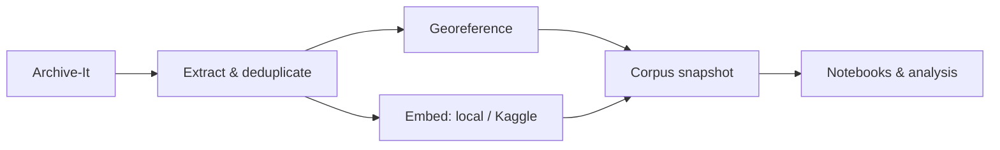

<p>
  
</p>

> Tracing COVID-era information spread

## Geographic attention


## Topic evolution


## The pipeline



**Text** · trafilatura + language detection &nbsp; **Places** · spaCy + GeoNames
**Semantics** · Qdrant + BERTopic &nbsp; **Execution** · Airflow + document checkpoints

| Archive-It collection                                                             | Coverage                                 |
| --------------------------------------------------------------------------------- | ---------------------------------------- |
| [13559 · False Coronavirus Information](https://archive-it.org/collections/13559) | Sources flagged for COVID misinformation |
| [13529 · Novel Coronavirus](https://archive-it.org/collections/13529)             | Broad, international COVID coverage      |

[Source registry](src/credibility/sources.py) · [Study periods](src/config.py) · **[Setup & commands →](airflow/README.md)**

## Explore the data

For local notebook work, install Python 3.13+ and uv:

```bash
uv sync --group dev
uv run jupyter lab notebooks/
```

| Notebook                                                | Explore                                      |
| ------------------------------------------------------- | -------------------------------------------- |
| [01 · Corpus](notebooks/01_normalized_eda.ipynb)        | Extraction quality, coverage, redundancy     |
| [02 · Geography](notebooks/02_georeferencing_eda.ipynb) | Places, credibility tiers, animated maps     |
| [03 · Semantics](notebooks/03_embeddings_eda.ipynb)     | Topics, temporal evolution, tier comparisons |

## Layout

`src/` — pipeline and analysis · `scripts/` — commands · `dags/` — workflows
`notebooks/` — exploration and exports · `data/` — generated data and checkpoints
