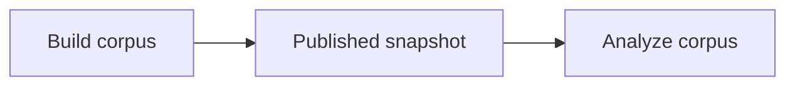

<p align="center">
  <a href="../README.md"></a>
</p>

# Airflow operations

**Airflow 3.1.5 · Docker Compose · checkpoint recovery**

[Install](#install) · [Daily commands](#daily-commands) · [New run](#start-a-new-run) · [Recovery](#features-and-recovery) · [Kaggle](#kaggle-embedding)



| DAG | Job |
| --- | --- |
| `credleaf_build_corpus` | Harvest → normalize → deduplicate → optional geography/embedding → publish |
| `credleaf_analyze_corpus` | Analyze a snapshot; optional monthly topics and animation |

Collections run independently; publication requires all requested stages to pass.
`credleaf_data_catalog` records output history in Assets without processing data.

## Install

From the repository root, with Docker and Compose installed:

```bash
export AIRFLOW_UID="$(id -u)"
mkdir -p data notebooks/animation_out
docker compose up -d --build
docker compose logs --tail 80 airflow
```

> **Open [localhost:8080](http://localhost:8080).** Login credentials appear in startup logs.

Before enabling geography, prepare its cache once:

```bash
docker compose exec airflow bash -c '$CREDLEAF_PYTHON -m georeferencing.setup_gazetteer'
```

## Daily commands

The zsh hook loads `af`, `ctl`, `DAG`, and `RUN` inside this project. `DAG` defaults
to the build workflow; `RUN` selects its active/latest run. Load manually with
`source .shell/shortcuts.zsh`; select another run with `RUN=your-run-id`.

**Services**

| Action | Command |
| --- | --- |
| Status | `docker compose ps` |
| Start existing containers | `docker compose start` |
| Save progress and stop | `docker compose stop --timeout 180` |
| Follow logs; Ctrl+C exits viewer | `docker compose logs -f --tail 80 airflow` |

**Inspect a run**

```bash
af dags list                              # Workflows
af dags list-runs "$DAG"                  # Runs
af dags state "$DAG" "$RUN"               # Overall status
af tasks states-for-dag-run "$DAG" "$RUN"  # Task statuses
```

**Pause / resume safely**

```bash
ctl pause  --dag-id "$DAG" --run-id "$RUN"
ctl resume --dag-id "$DAG" --run-id "$RUN"
```

`af` runs Airflow inside Docker; `ctl` uses checkpoint controls. Ordinary
`af dags pause/unpause` controls scheduling, not active workers. `upstream_failed`
means an earlier task failed. Use `start` daily; `up -d --build` applies updates.
More options: `af --help`.

## Start a new run

**Build a pilot** — five seeds per collection, ten captures per seed;
geography and embeddings off:

```bash
af dags unpause credleaf_build_corpus
af dags trigger credleaf_build_corpus \
  --run-id "pilot-$(date +%Y%m%d-%H%M%S)" \
  --conf "$(cat airflow/profiles/discovery-pilot.json)"
```

**Analyze a snapshot** — replace `publish-…` with the ID from `publish_corpus`:

```bash
af dags unpause credleaf_analyze_corpus
af dags trigger credleaf_analyze_corpus \
  --run-id "analysis-$(date +%Y%m%d-%H%M%S)" \
  --conf '{"snapshot_id":"publish-…","topic_mode":"build","animation_mode":"build"}'
```

> **Trigger** starts a new run. **Resume** continues an existing one. One run per DAG can be active.

Stage modes: **build**, **reuse**, or **off** for optional stages. Reuse needs
`base_snapshot_id` / `base_analysis_id` and matching inputs, settings, and code.
[All parameters and defaults →](../src/pipeline/spec.py)

## Features and recovery

| Feature | Behavior |
| --- | --- |
| Snapshots | Immutable, checksummed outputs; analysis reads saved vectors without archive or Qdrant access |
| Progress | Run tab updates every 5 seconds; Notes/XComs show ETA and counts; Assets records versions |
| Shutdown | Normalization and local embedding retain document checkpoints; other unfinished stages restart |
| Resume | Interrupted runs recover after restart; manual pauses stay paused |
| Failures | Clearing resets task state, not checkpoints; recorded document failures need a separate repair pass |
| Code changes | Updating pinned code/packages requires a new run or verified checkpoint migration |

> **Persistent data:** keep `data/pipeline/`, `data/cache/`, `data/qdrant/`, and
> `airflow_state`. `docker compose down --volumes` deletes Airflow's saved state.

A forced shutdown may repeat the current document. Fix errors before retrying;
inspect `af tasks clear --help` first, since it can match multiple historical runs.

## Kaggle embedding

One **embed** task, two backends: `embed_backend=local` (default) or `kaggle`, with
`embed_mode=build`. Private GPU shards return validated vectors to normal corpus
publication. Submitted jobs can continue while the PC is off; polling resumes.

| Connection `kaggle_default` | Value |
| --- | --- |
| Login | Kaggle username |
| Password | API token |
| Extra | `{"auth_type":"token"}`; use `legacy` for an old API key |

Select with `kaggle_connection_id`. Tune `kaggle_shard_documents` for job size and
`kaggle_encode_batch_size` for GPU memory. CLI: `bash airflow/kaggle.sh --help`.

<details>
<summary><strong>Local development</strong> — separate Airflow and ML environments</summary>

```bash
uv sync --group dev
uv venv .venv-airflow --python 3.13
uv pip install --python .venv-airflow/bin/python -r airflow/requirements.txt
bash scripts/airflow.sh standalone
```

This uses `data/airflow/`, separate from Docker's Airflow metadata.

</details>
