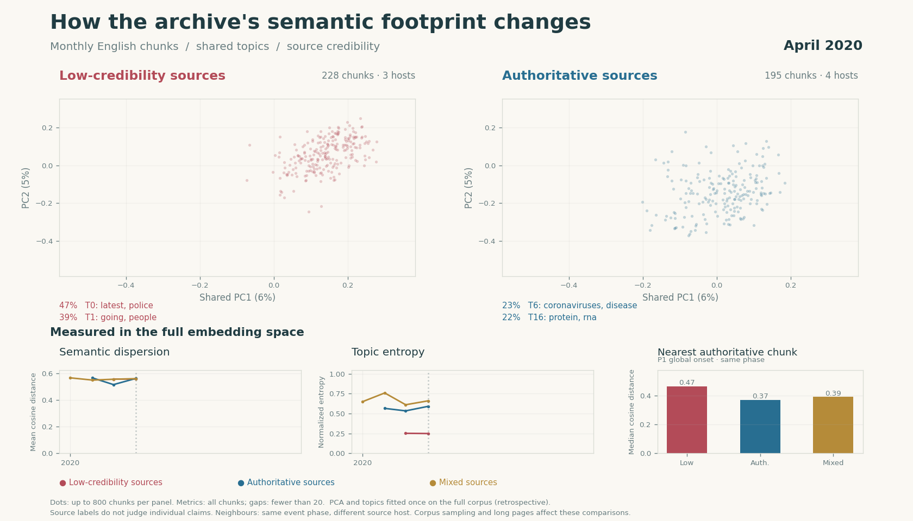

# Semantic analysis — 2026-11-02

Recomputed from the successful overnight extraction and its verified BAAI/bge-m3
embedding snapshot. Both analysis stages and both animations completed in Airflow.

| Measure | Result |
| --- | --- |
| Input chunks | 28,451 |
| Retained chunks | 5,606 |
| Distinct captured page URLs | 135 |
| Event dates | 2020-01-31 through 2020-11-30 |
| Low / authoritative / mixed chunks | 1,799 / 1,144 / 2,663 |
| Low / authoritative / mixed hosts | 4 / 12 / 78 |
| Global topics / outlier chunks | 31 / 12.1% |
| Monthly topic snapshots / graph edges | 60 / 38 |
| Animation frames | 11 each |

The retained sample covers only the onset phase. The extraction attempted the
first 3,000 captures per collection, rather than balancing capture or publication
dates. These results are archived separately from the README's restored broader
sample; they do not demonstrate change over later pandemic phases. Source tiers
describe domains, not the truth of individual claims. Language filtering uses stored document
labels, which can leave mixed-language snippets in the English sample.

For the onset phase, low-tier dispersion is 0.569 versus 0.562 for authoritative
sources; median distance to an eligible authoritative neighbour is 0.465 versus
0.370. Normalized topic entropy is 0.309 versus 0.699. Metrics weight chunks,
not articles or hosts; long pages, index content, source mix and reference-pool
size affect the comparisons. See [phase metrics](phases.csv),
[monthly metrics](monthly.csv) and [neighbour summaries](neighbour_summary.csv).



The [comparison GIF](semantic_comparison.gif) shows the shared retrospective PCA
view and full-space metrics. The [topic-tree GIF](https://github.com/Ala-ADN/credleaf/blob/9ee16efaafd80e6ab550804b9c5af7c8ce82d925/notebooks/animation_out/semantic_evolution.gif)
shows 12 selected lineages from 48 total, with article counts. Both use automatic
topic keywords; historical reviewed labels belong to the earlier topic fit.

## Provenance and reproduction

- Input snapshot: `publish-881c9bba55c2b35894e3589a51291bc0`.
- Analysis snapshot: `publish-293c551297beeb532139106d2a96d3e4`.
- Airflow run: `analysis-publish-20261102`.
- Encoder: `BAAI/bge-m3`, 1,024 dimensions.
- Global topic minimum: 50 chunks; monthly topic minimum: 20 chunks.
- Metric minimum: 20 chunks; all random seeds: 42.
- Topic graph threshold: 0.45; displayed tree threshold: 0.55.

[provenance.json](provenance.json) records artifact references, file hashes,
the code identity and sample counts. [metadata.json](metadata.json) records
metric definitions, software versions and the actual Qdrant collection.
[analysis_config.json](analysis_config.json) contains the exact run settings.

With the input snapshot available in the local artifact store:

```bash
docker compose exec -T airflow airflow dags trigger credleaf_analyze_corpus \
  --conf "$(cat reports/semantic-2026-11-02/analysis_config.json)"
```

To rerender the topic tree using only the committed exports:

```bash
uv run python scripts/animate_topics.py \
  --input-dir reports/semantic-2026-11-02/topic_evolution \
  --labels reports/semantic-2026-11-02/display_labels.json \
  --gif /tmp/semantic_evolution.gif --max-topics 12 --threshold 0.55
```

The portable topic provenance retains point IDs and page URLs for article
counts, omitting chunk text. Full chunk text and embedding arrays remain in the
local immutable artifact store; reproducing the topic fit requires that snapshot.
