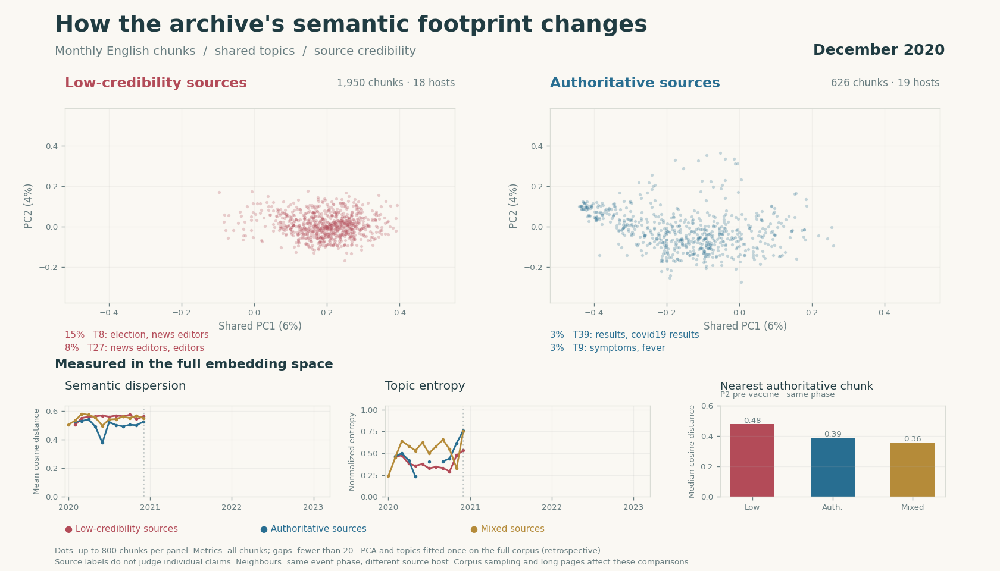

# Semantic analysis — Kaggle embeddings, 2026-11-05

Recomputed from the completed Kaggle run, including semantic comparison, monthly
topic networks and both animations. All stages completed in Airflow.

[Semantic comparison GIF](semantic_comparison.gif) · [Topic-evolution GIF](semantic_evolution.gif)

| Measure | Result |
| --- | --- |
| Imported embeddings | 72,137 unique chunks, 1,024 dimensions |
| Cross-shard duplicate points removed | 6 |
| Retained analysis chunks | 41,974 |
| Distinct retained captured page URLs | 593 |
| Event dates | 2020-01-31 through 2023-03-21 |
| Monthly frames | 39 |
| Low / authoritative / mixed chunks | 9,697 / 10,663 / 21,614 |
| Low / authoritative / mixed hosts | 20 / 63 / 441 |
| Global topics / outlier fraction | 159 / 29.8% |
| Monthly topic snapshots / graph links | 475 / 876 |

## What the results show

Low-tier chunks have higher semantic dispersion and greater median distance to
an eligible authoritative neighbour in all five phases with both tiers. Their
normalized topic entropy is lower. Neighbours are matched within the same phase
and exclude the query's source host. All metrics below use the full embedding
space, not the two-dimensional display.

| Phase | Dispersion low / authoritative | Median neighbour distance low / authoritative | Entropy low / authoritative |
| --- | --- | --- | --- |
| global onset | 0.567 / 0.540 | 0.450 / 0.333 | 0.418 / 0.654 |
| pre vaccine | 0.560 / 0.524 | 0.479 / 0.387 | 0.532 / 0.760 |
| vaccine rollout | 0.560 / 0.497 | 0.491 / 0.339 | 0.153 / 0.727 |
| delta wave | 0.563 / 0.518 | 0.489 / 0.380 | 0.058 / 0.358 |
| omicron wave | 0.563 / 0.539 | 0.490 / 0.375 | 0.054 / 0.510 |

## Interpretation and visual quality

- The comparison GIF now spans 39 months. Its shared PCA coordinates explain only
  about 10% of embedding variance, so a tighter-looking 2D cloud need not have
  lower full-space dispersion. The metric panels provide the quantitative comparison.
- From vaccine rollout through Omicron, only two low-tier hosts remain. The
  transition phase has no low-tier observations. Later comparisons cannot be
  generalized to low-credibility reporting overall.
- Chunks are weighted equally; articles and hosts are not balanced. Long pages
  can dominate. The largest global cluster (`just / market / going / inflation`)
  contains 4,872 chunks, including 4,409 from zerohedge.com. Citation and navigation
  text also form prominent clusters. Source labels do not classify individual
  claims as true or false.
- The topic-tree animation displays 12 selected lineages (62 snapshots) from
  the full graph, using automatic keyword names. Several names repeat generic
  COVID terms. Publication-quality interpretation needs content cleaning and
  reviewed labels before assigning narrative meanings to branches.

Next priorities are removal of navigation/bibliographic text and off-topic
material, source/article-balanced sensitivity checks, and reviewed topic names.
The current results are descriptive corpus analysis, not causal evidence.

## Provenance

- Kaggle embedding run: `kaggle-normalized-20261105`.
- Input corpus: `publish-a3f864f71ad4ebbd3d9a508af3f93623`.
- Analysis run: `analysis-kaggle-20261105`.
- Analysis snapshot: `publish-06a76161b081eef9c1bde62b55355897`.
- Encoder: `BAAI/bge-m3`, revision `5617a9f61b028005a4858fdac845db406aefb181`.
- Global topic minimum: 50; monthly topic minimum: 20; seed: 42.
- Filtering: primary collections, stored English labels, at least eight words,
  valid study-period event dates and finite nonzero vectors; repeated source/text
  chunks within a month are removed. Publication dates take precedence over capture times.

[Analysis configuration](analysis_config.json), [metric definitions](metadata.json)
and [checksummed provenance](provenance.json) accompany the exported results.
Original scientific artifacts, full chunk tables and vectors remain in the
immutable local artifact store. Historical GIFs and reports remain available.
